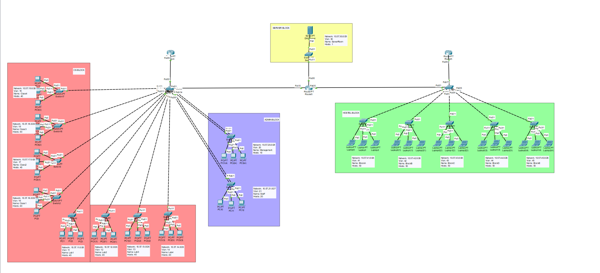

# Smart Campus Network

A simulated campus network for a small university, designed and configured in Cisco Packet Tracer. It was built for a Computer Networks course project.

## Overview

The campus is split into four blocks, each on its own VLANs and connected through three routers.

| Block | VLANs | Subnets (10.57.x.x) | Hosts per VLAN |
|---|---|---|---|
| Computer Science: labs | 11 to 14 (Lab1 to Lab4) | 10.57.11.0/26 to 10.57.14.0/26 | 40 |
| Computer Science: classrooms | 16 to 19 (Class1 to Class4) | 10.57.16.0/26 to 10.57.19.0/26 | 40 |
| Admin | 20 (Management), 21 (Staff) | 10.57.20.0/28, 10.57.21.0/27 | 10, 20 |
| Hostel | 41 to 45 (Block A to Block E) | 10.57.41.0/26 to 10.57.45.0/26 | 50 |
| Server | 30 (Server room) | 10.57.30.0/29 | 1 (DNS server) |

That makes 16 VLANs in total, addressed with VLSM so each subnet is sized to the number of hosts it serves.

## What is configured

- Separate VLANs per block, trunked between the switches
- Inter-VLAN routing, so VLANs can talk to each other
- Dynamic routing between the three routers
- EtherChannel link aggregation for redundant links
- Port security on the access ports
- A DNS server in its own server VLAN, used to test end-to-end connectivity across the campus

## Testing

Connectivity was verified with ping and traceroute between VLANs, by checking the routing tables on the routers, and by testing how port security reacts to a violation.

## Running it

Open `Smart-Campus-Network.pkt` in Cisco Packet Tracer 8.x.
